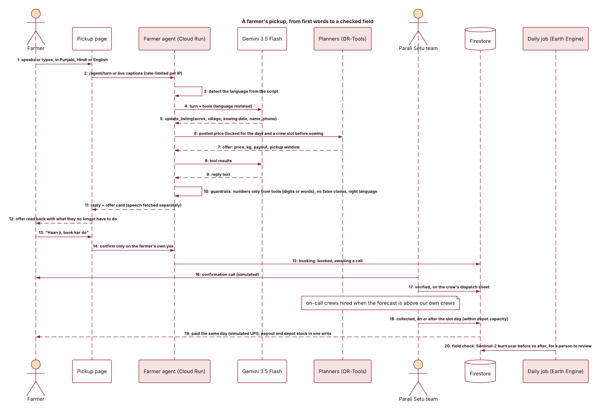

# Parali Setu

**Every October, Punjab's paddy fields burn. Parali Setu buys the straw instead.**

ਪਰਾਲੀ ਨਾ ਸਾੜੋ, ਸਾਨੂੰ ਵੇਚੋ। A farmer books a pickup by simply talking, in Punjabi, Hindi or
English, with no language to pick. Our team calls to confirm, a crew clears the field before
wheat sowing, and the farmer is paid the same day. We store the straw at our depots and
supply industry all year. No vendors to chase, no machines to rent.

Google Cloud AI Builder Cup 2026 · Sustainability & Social Impact · Team Ctrl Alt Conquer (Navneet Kumar, Sainath)

| | |
|---|---|
| Live site | https://parali-setu-aibuildercup2026.web.app |
| Pickup page (farmers) | https://parali-setu-aibuildercup2026.web.app/kisan/ (one page for phone and laptop) |
| Operations console | https://parali-setu-aibuildercup2026.web.app/ops/ (Dispatch, Routes, Forecast, Depots, Prices, Orders, Impact) |
| Customer portal | https://parali-setu-aibuildercup2026.web.app/company/ |
| Architecture | [docs/ARCHITECTURE.md](docs/ARCHITECTURE.md) |

*Parali* is Punjabi for paddy straw; *setu* means bridge.


## The problem

**The toll:**
- Living in a district with intense crop burning triples the risk of acute respiratory infection, and children under five are most affected ([IFPRI](https://www.ifpri.org/news-release/new-study-air-pollution-indias-stubble-burning-leads-usd-15-billion-economic-losses)).
- Each tonne burned releases about 0.18 t CO₂e of methane and nitrous oxide and about 8 kg of PM2.5.

**Fewer fires counted, the same area burned:**
- Punjab's counted farm fires fell from 36,663 in 2023 to 10,909 in 2024 (CREAMS, via a [Rajya Sabha reply](https://rsdebate.nic.in/bitstream/123456789/753234/1/PQ_266_20122024_U2905_p94_p95.pdf)).
- The area burned is reported as unchanged: 19.17 lakh ha in 2024 against 19.14 lakh ha in 2023 (PRSC/PPCB figures as reported by secondary sources; we have not seen the primary report).

**Industry already wants the straw:** use off the field reached 5.96 Mt in 2024, against a target of about 7 Mt in 2025.

So why does a farmer still burn? Per acre of paddy:

| | |
|---|---|
| Straw produced | 17–18 quintals |
| Its value delivered to a plant | ₹2,200–3,000 |
| Baling and transport, paid by the farmer | ₹2,500–4,000 |
| Burning | about ₹500 and one day |
| Time before wheat must be sown | 10–15 days |

Selling the straw nets the farmer roughly nothing, and a baler that arrives after sowing is
worthless. **Parali Setu takes the whole job off the farmer and makes money on the other
side:** collecting efficiently, storing, and selling year-round to plants that today buy in a
six-week rush.

## How it works

1. **Talk once, in any of three languages.** The pickup page opens straight into a conversation (ਬੋਲੋ · बोलिए · Speak). The language is read from what the farmer says or types: Gurmukhi, Devanagari, English, or romanised Punjabi or Hindi. The agent answers, and speaks, in that language and follows a switch mid-chat. Other languages get a three-language "I can talk in Punjabi, Hindi or English".
2. **The agent asks only what's missing**: acres, village, sowing date, name and mobile. It cross-checks what doesn't fit (10 acres with 3,000 kg, a harvest after sowing), answers questions about payment, weighing and no-shows from fixed service terms, and reads the details back.
3. **One fair price.** Each district gets one posted farm-gate price per day (₹0.5–1.5/kg) from the procurement optimizer. It never changes during the day, and there is no bargaining.
4. **A slot before sowing.** The routing model books the farm on one of our crews; when ours are full, an **on-call crew** hired for the day takes it. The offer card shows the payout and what the farmer no longer has to do: rent a baler, find labour, make trolley trips, race the sowing date.
5. **A person confirms, then the crew goes.** A booking needs the farmer's own yes. It then waits in the ops **Calls to make** queue; only pickups our team has confirmed by phone (simulated) go on a crew's dispatch sheet.
6. **Paid the same day.** When the crew collects, the payout is recorded (simulated UPI) and the straw goes into depot stock.
7. **Ready for the peak.** The ops Dispatch board compares the acres farmers are forecast to book each day with what our own crews clear, and says how many on-call crews to hire, or to sign up before the peak.
8. **Supplied all year.** Companies price an order in one sentence, see what we can commit month by month, and sign. Orders signed first keep their stock.



## Google Cloud, and what each part does

| Service | Role |
|---|---|
| **Vertex AI · Gemini 3.5 Flash** (global) | The farmer's talking agent, using function calling. About 1 s per step in our tests on 17 Oct 2026, while 3.8 Flash on the same endpoint was returning 429s and 504s. A step that is slow or rate-limited goes straight to **Gemini 2.5 Flash in Mumbai**. Also hears recorded audio, grades photos and explains prices. **Never produces a number.** |
| **Gemini live transcription** (global) | "Live words": captions appear while the farmer speaks; it listens for Punjabi, Hindi and English at once. The final words go through the same guarded agent. |
| **Text-to-Speech / Speech-to-Text** | Spoken replies in Chirp 3 HD voices (pa-IN, hi-IN, en-IN), fetched alongside the reply text so the farmer never waits on audio. Speech-to-Text is the fallback when Gemini can't hear a recording. |
| **BigQuery** | Weekly series of 25 paddy seasons of fire detections per district. **TimesFM (`AI.FORECAST`)** forecasts this season's harvest timing; **ARIMA_PLUS** and a same-as-last-year baseline are backtested against it. |
| **Earth Engine** | NASA FIRMS fire detections, 2001–2026, counted per day within FAO GAUL 2025 district boundaries for Punjab and Haryana. |
| **Cloud Run** | The API, with three OR-Tools planners (procurement LP, routing model, delivery LP), verification, readiness and the WebSocket for live words. Also the daily fire refresh and weekly forecast jobs, triggered by **Cloud Scheduler**. |
| **Firestore** | Bookings and their verification, depots, crews, slots, posted prices, purchases, stock moves, customers, orders, deliveries, plans, forecasts, conversations. |
| **Firebase Hosting** | The landing page, pickup page, ops console and customer portal, in one shared design system. |
| **Maps JavaScript API** | Crew routes in the ops console. |
| **Billing budgets + Pub/Sub + Cloud Run function** | Cost guard. Emails both teammates, and closes the API and turns off the AI APIs if real money is ever charged. |

The design rule: **language from Gemini, numbers from optimizers, timing from satellites.**
See [docs/ARCHITECTURE.md](docs/ARCHITECTURE.md) for the agent's guardrails, the planners and
the data model. The diagrams are in Lucid: [architecture](https://lucid.app/lucidchart/71517140-63d4-45a5-8994-0c0a74ad539d/view) and [booking flow](https://lucid.app/lucidchart/e03e3d31-b761-48cd-9826-31183ce98f61/view).

## Speed

Voice booking is the point, so each turn is kept short:
- two model calls per farmer message, not three (complete details bring the offer back in the same step)
- a 5 s budget per step, then the regional fallback; a rate-limited model is skipped for 30 s
- the language read in code, and the English record translated in the background
- routing for the agent capped at 1 s
- the reply text shown at once, speech fetched alongside

Measured locally against real Gemini on 17 Oct 2026: a typed turn takes 3–4 s in process and a median of about 5.8 s over HTTP, down from 10–25 s. Gemini's own response time (1–3 s a call) is now the floor.

## Forecasting, honestly

- **Supply timing.** The weekly fire detections per district (2002–2026) are real data. Both models saw data up to 30 June of a season and forecast September to December. Scores on two held-out seasons (lower is better):

| Season | Model | Season-shape error | Peak off by | Volume error |
|---|---|---|---|---|
| 2024 | **TimesFM** | **0.51** | **0.7 wk** | 1.78 |
| 2024 | ARIMA_PLUS | 1.13 | 5.2 wk | 0.99 |
| 2024 | Same as last year | 0.63 | 0.9 wk | 1.40 |
| 2025 | **TimesFM** | **0.66** | **0.8 wk** | 1.58 |
| 2025 | ARIMA_PLUS | 1.15 | 4.1 wk | 0.99 |
| 2025 | Same as last year | 0.70 | 1.0 wk | 0.83 |

  TimesFM gets the **timing** right. No model gets the **volume** right, because enforcement cut fire counts while the burned area held. So we use fires only for timing.
- **Supply volume** comes from the Ministry of Agriculture's APY crop statistics (via Kaggle): district rice production × a straw-to-grain ratio of 1.5.
- **Bookings we expect** are 0.5% of each district's straw, a first-season pilot in eight districts (an assumption). That is about 1,000 acres a day at the 2 November peak, against 180 acres a day for our own crews: the Dispatch board asks for up to 36 on-call crews a day and 10 more signed up before the peak. At 3% it would be about 300 crews a day.
- **Demand** is derived from published consumption by segment (biomass power, CBG, boilers, pellets), not trained: no public time series exists. It is labelled that way everywhere.

## The money, honestly

- **Pricing.** Farmers get today's posted price: a base of ₹0.60/kg, plus a bounded share of the procurement LP's shadow price where we need more straw than we expect to be booked.
- **Quotes.** A customer's quote is built from whole-rupee costs (farm-gate + collection + storage + haulage + 10% margin), shown against the ₹1,690/t plants pay at harvest. A new order only gets stock that earlier orders don't hold.
- **Assumptions.** The collection, storage and freight costs, the booking share and the on-call pool are our working assumptions, labelled as such on the ops console (`GET /costs`).
- **The catch.** At today's prices the margin is thin. The business depends on collecting more cheaply than hired balers (₹1,430–2,290/t), which is the routing model's job, and on industry valuing year-round supply.

## What's real and what's simulated

**Real:**
- satellite fire history, the TimesFM forecast and its backtests
- crop statistics and published demand figures
- the Gemini agent, language detection, live words and voice
- all three optimizers and the readiness model

**Simulated:**
- farms, customers, crews and on-call crews (all demo data)
- the confirmation calls, SMS and payments
- the cost figures marked "assumption"

## Repository layout

```
parali-setu-api/        FastAPI on Cloud Run (README inside)
  agent.py              farmer talking agent: Gemini function calling + guardrails
  language.py           which language the farmer speaks, read from the text
  live.py               live words: streaming transcription, three languages at once
  procurement.py        LP: what to buy where; posted prices from shadow prices
  scheduler.py          routing: crew slots before sowing, on-call crews
  deliveries.py         LP: depot -> customer orders, earliest signed first
  costs.py              cost model and quotes
  operations.py         runs the planners on live data; forecast readiness
  pickups.py            bookings, verification, slots, same-day payouts, stock
  forecast/             FIRMS history, crop statistics, BigQuery TimesFM/ARIMA pipeline
parali-setu-frontend/   Firebase Hosting: / (landing), kisan/, ops/, company/, shared/tokens.css
ops/cost-guard/         budget-triggered kill switch + restore script
docs/                   ARCHITECTURE.md; the original PRD (historical)
```

## Run it locally

Requires Python 3.12 and Application Default Credentials (`gcloud auth application-default login`).

```bash
python -m venv .venv && .venv/Scripts/pip install -r parali-setu-api/requirements.txt
cd parali-setu-api && python dev_server.py      # real Gemini and voice, in-memory demo data, :8080
cd parali-setu-frontend && python -m http.server 8000
# set API_BASE in parali-setu-frontend/config.js to http://127.0.0.1:8080
```

```bash
.venv/Scripts/python -m pytest parali-setu-api ops/cost-guard   # no credentials needed
python parali-setu-api/tests/live_smoke.py                      # real services; run reset_demo first
```

**Forecast pipeline:**

```bash
cd parali-setu-api
python -m forecast.firms_history --from 2001 --to 2026 --out forecast/data/fires_daily.csv
python -m forecast.crop_production --raw "forecast/data/raw/pyatakov/India Agriculture Crop Production.csv"
python -m forecast.pipeline backtest --season 2024      # and 2025
python -m forecast.pipeline live                        # this season's timing forecast
```

**Demo data:**

```bash
python parali-setu-api/reset_demo.py --yes
```

This wipes Parali Setu's own collections and seeds:
- 5 depots, each with its own crews and a pool of 8 on-call crews
- 5 demo customers with orders
- 25 farm bookings
- a small confirmed, collected and paid run

## Deploy

```bash
gcloud run deploy parali-setu-api --source parali-setu-api --project <project> --region asia-southeast1 \
  --allow-unauthenticated --memory 1Gi --timeout 300 --max-instances 3 \
  --set-env-vars GCP_PROJECT_ID=<project>,GEMINI_MODEL=gemini-3.5-flash,AGENT_PLATFORM_LOCATION=global
firebase deploy --only hosting:parali-setu --project <project>
```

The daily fire refresh is the Cloud Run job `parali-setu-firms` (Cloud Scheduler `parali-setu-firms-daily`, 06:30 IST); the weekly forecast refresh is `parali-setu-forecast` (`parali-setu-forecast-weekly`, Mondays 07:00 IST).

## Roadmap

- **Streaming replies.** Show the agent's words as they are generated, for a sub-second first word.
- **WhatsApp and missed-call channels** in front of the same agent.
- **Real verification calls** from a call-centre tool, and **real SMS**.
- **One joint model** for buying, routing and delivery. **Routes API** travel times.
- **Real operations:** onboarding real balers, CHCs and aggregators as on-call crews; UPI payouts; farmer phone sign-in.

## Credits

The original Parali Setu prototype (the PRD, a matching LP, Gemini extraction, voice I/O) was
built by Sainath. Those commits are preserved in this repository's history. Version 2.0
turns it into a buyer-of-record service:
- the agent and the any-language pickup page
- the forecasting and readiness
- the three planners and verification before dispatch
- the ops console and customer portal, in one phulkari design system
