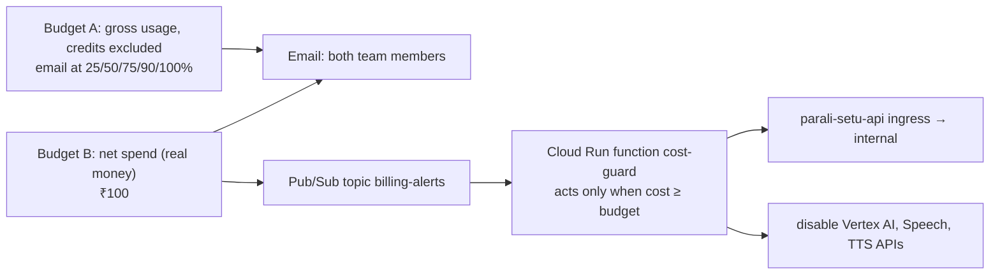
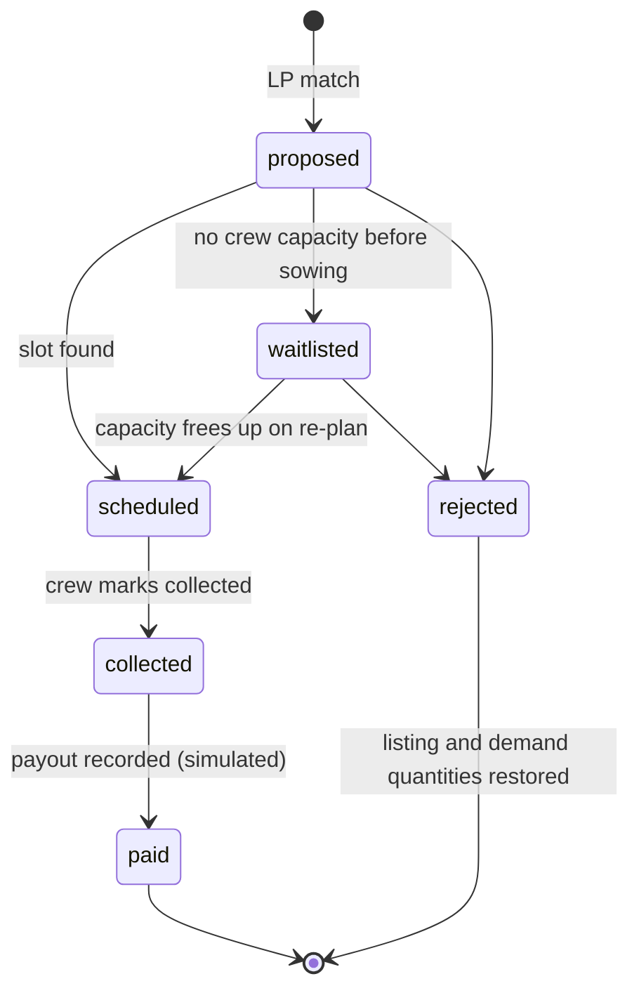

# Parali Setu architecture

This document describes the system as it is built and deployed today. The diagrams
render on GitHub. The overview image is exported from the team's Lucid diagrams.


## The rule the design is built on

Parali Setu has three layers, and each one owns a different kind of output:

| Layer | Code | Owns | Never does |
|---|---|---|---|
| Language | `extraction.py`, `gemini_client.py`, `speech.py`, `phrases.py` | Understanding speech, text and photos; asking the one follow-up question; explaining results in Punjabi, Hindi or English | Produce a price, a quantity, a date or a slot |
| Market | `solver.py`, `negotiation.py` | Which buyer takes which listing, how much, at what price | Talk to the user |
| Logistics | `scheduler.py`, `pickups.py` | Which crew collects which farm, on which day, in which 3-hour window | Change a price or a match |

Every number a farmer or buyer sees comes from the market or logistics layer, or from
`impact.py`. Gemini receives those numbers and puts them into words. When Gemini is
unavailable, deterministic templates (`phrases.py`) read the details back instead. A
quota error triggers a 60-second cooldown, so one rate limit doesn't take the
language layer down for the rest of the session.

## Deployment

```mermaid
flowchart LR
  subgraph Users
    F[Farmer<br/>phone, pa/hi/en]
    B[Buyer ops<br/>desktop]
    J[Public / judges]
  end
  subgraph FH[Firebase Hosting: parali-setu.web.app]
    K["/kisan<br/>voice listing PWA"]
    BC["/buyer<br/>ops console"]
    L["/<br/>landing + impact"]
  end
  subgraph CR[Cloud Run: parali-setu-api, asia-southeast1]
    API[FastAPI main.py]
    LP[solver.py<br/>OR-Tools GLOP LP]
    RT[scheduler.py<br/>OR-Tools routing CVRPTW]
    IM[impact.py]
  end
  G[Vertex AI<br/>Gemini]
  STT[Cloud Speech-to-Text<br/>pa-IN, hi-IN]
  TTS[Cloud Text-to-Speech<br/>Chirp3-HD]
  FS[(Firestore)]
  BQ[(BigQuery ML<br/>ARIMA_PLUS)]
  EE[Earth Engine<br/>NASA FIRMS]
  MJ[Maps JavaScript API]

  F --> K --> API
  B --> BC --> API
  J --> L --> API
  BC -.-> MJ
  L -.-> MJ
  API --> G & STT & TTS & FS
  API --> LP & RT & IM
  BQ -. batch: forecast_pipeline.py .-> FS
  EE -. batch: fetch_fire_data.py .-> FS
```

Cost protection (`ops/cost-guard/`):



`--max-instances=3` on the API caps a runaway before any bill appears. `ops/cost-guard/restore.sh` reverses the throttle.

## Farmer flow: speak once, confirm once

```mermaid
sequenceDiagram
  actor F as Farmer (/kisan)
  participant API as Cloud Run API
  participant STT as Speech-to-Text
  participant G as Gemini (Vertex AI)
  participant LP as solver.py (LP)
  participant RT as scheduler.py (routing)
  participant FS as Firestore
  participant TTS as Text-to-Speech

  F->>API: POST /listings/draft (voice, optional photo and GPS)
  API->>STT: transcribe (pa-IN / hi-IN)
  API->>G: extract acres, crop, district, sowing date
  API->>G: grade stubble photo (optional)
  Note over API: kg = acres × 1.75 t, computed in code
  alt a field is missing
    API->>G: phrase ONE question covering every missing field
    API-->>F: question (text + TTS); the answer merges into the same draft
  end
  API-->>F: confirm card (deterministic read-back)
  F->>API: POST /listings/{draft_id}/confirm
  API->>FS: save listing
  API->>LP: global solve (crop, quality, service radius, ceiling)
  API->>RT: plan the buyer's crews around locked slots
  API->>FS: matches, pickup_slots (or waitlist + reason)
  API->>G: narrate the offer
  API->>TTS: speak it
  API-->>F: offer: buyer, slot, ₹ payout, CO₂e avoided
  F->>API: POST /matches/{id}/accept-slot
  API->>FS: lock slot (later re-plans must keep it)
```

## Buyer flow: demand, re-plan, collect, pay

```mermaid
sequenceDiagram
  actor B as Buyer ops (/buyer)
  participant API as Cloud Run API
  participant LP as solver.py
  participant RT as scheduler.py
  participant FS as Firestore

  B->>API: POST /companies/{id}/demand
  API->>LP: global solve, persist every new match
  B->>API: POST /schedule/solve (Re-plan)
  API->>RT: crew-days × farms, locked slots pinned
  RT-->>API: route sheets + unschedulable farms with reasons
  API->>FS: pickup_slots; waitlist or promote matches
  B->>API: GET /buyers/{id}/schedule
  API-->>B: per-crew daily route (Google Maps) + waitlist
  B->>API: POST /stops/{match_id}/collected
  API->>FS: match → collected, payout record (simulated), match → paid
  B->>API: GET /buyers/{id}/impact
```

## Match lifecycle



Transitions are enforced by `firestore_store.update_match_status` inside a Firestore
transaction. Listing and demand remaining quantities are adjusted in the same
transaction, so two buyers can't take the same kilogram.

## The two optimizers

**Market: `solver.py`**, a transportation linear program solved with OR-Tools GLOP.
- **Variables:** kg moved from each listing to each eligible demand.
- **Objective:** buyer price × urgency weight (up to 2× as the stubble's ready date nears) × trust weight (0.85–1.15×, from no-burn proofs cross-checked with FIRMS). Urgency and trust change who is served first, not the price paid.
- **Eligibility:**
  - crop and quality match
  - the farm is inside the buyer's service radius (haversine from depot; default 75 km)
  - the price is within the buyer's ceiling (offer × 1.2 unless stated)
- **Negotiation:** `negotiation_rounds` runs alternating concessions between the farmer's floor and the buyer's ceiling. The agreed price is validated by `apply_negotiation` before anything is saved. Gemini only narrates each side's number.

**Logistics: `scheduler.py`**, a capacitated vehicle routing problem with time windows (OR-Tools routing).
- **Vehicles:** each crew on each day of a 10-day horizon is one vehicle. It leaves the buyer's depot inside a 07:00–18:00 shift and has an acre capacity (20 acres/day by default).
- **Farm nodes:**
  - service time = acres ÷ 2 acres/hour
  - a time window from ready date to the day before sowing
  - only the matched buyer's crews are allowed
  - farms bigger than one crew-day are split into visits
- **Locked slots** (the farmer accepted) are pinned to their crew-day and start time. Dropping one costs 100× more than dropping a new farm.
- **Unschedulable farms** are dropped through disjunctions and reported with a reason ("no crew capacity before sowing", "fully booked", "deadline passed"), never silently. They become `waitlisted`.
- **Travel:** straight-line km × 1.3 road factor at 30 km/h. Planning runs in IST, and same-day slots need 60 minutes of lead time.
- **Search:** cheapest-arc first solution, then guided local search with a 3-second limit. Tests use the deterministic first-solution mode.

**Why two stages:** matching first and then routing is a deliberate decomposition. It keeps both models small enough to solve in seconds on Cloud Run. Farms routing can't serve are fed back as waitlisted matches. A joint model is on the roadmap.

## Data model (Firestore)

| Collection | Written by | Holds |
|---|---|---|
| `listing_drafts` | `/listings/draft` | Extracted fields, missing fields, transcript, until confirmed |
| `listings` | confirm | acres, kg, remaining kg, crop, quality, district, lat/lon, sowing deadline |
| `companies` | `reset_demo.py` | Buyer name, depot, service radius |
| `demand` | buyer console | kg needed and remaining, offer price, ceiling |
| `matches` | LP | listing ↔ demand, kg, agreed price, lifecycle status |
| `crews` | `reset_demo.py` | Crew per buyer, acres per day, shift |
| `pickup_slots` | scheduler | Crew, day, arrival window, locked flag, status |
| `payouts` | collected | kg × agreed price (simulated payment) |
| `negotiation_sessions` | `/negotiate/agents` | Turns and converged price; confirming is allowed once |
| `no_burn_proofs`, `farmers` | Kisan | Proof photos and verdicts, trust score |
| `forecasts` | `forecast_pipeline.py` | BigQuery ML demand forecast (synthetic corpus) |
| `fire_detections` | `fetch_fire_data.py` | NASA FIRMS points from Earth Engine |

## Impact model (`impact.py`)

Per tonne of straw collected instead of burned:

| Quantity | Factor | Source |
|---|---|---|
| Methane | 5.82 kg × GWP 27 | Gadde et al. 2009; IPCC AR6 |
| Nitrous oxide | 0.1 kg × GWP 273 | Gadde et al. 2009; IPCC AR6 |
| **GHG avoided** | **≈ 0.184 t CO₂e** | sum of the two |
| PM2.5 | 8.3 kg (range 4.7–20) | field-burning studies |
| CO | 102 kg | Gadde et al. 2009 |
| Coal displaced (only if the buyer co-fires) | 1.33 t CO₂ | energy-content estimate; shown separately, never in the headline |
| Clearing cost avoided | ₹2,500–4,000 per acre at 1.75 t/acre | Tribune; Hindustan Times |

CO₂ from burning straw is biogenic and is **not** counted. The landing page's scenario
slider applies the same factors to a share of Punjab's ~19.7 Mt of paddy straw.

## Known limitations

- **Demo data:**
  - buyers, crews and listings are demo data
  - payments are simulated
  - the BigQuery ML forecast is trained on a synthetic corpus
- **Not live:** fire detections are a batch refresh.
- **Assumptions:**
  - the baling rate (2 acres/hour) and crew capacity (20 acres/day) still need a field source
  - travel times are estimates, not Routes API results
- **Not built yet:** authentication; per-user rate limiting (requests are bounded by pydantic and CORS, and the instance count is capped).
