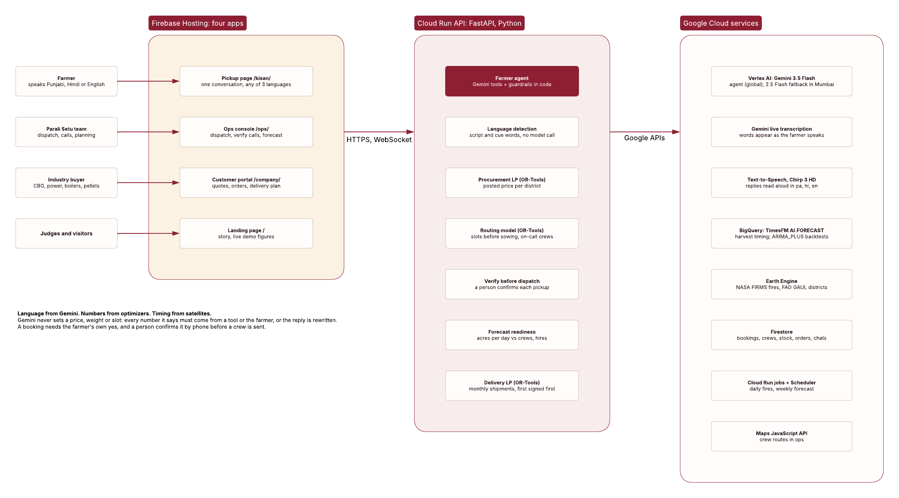
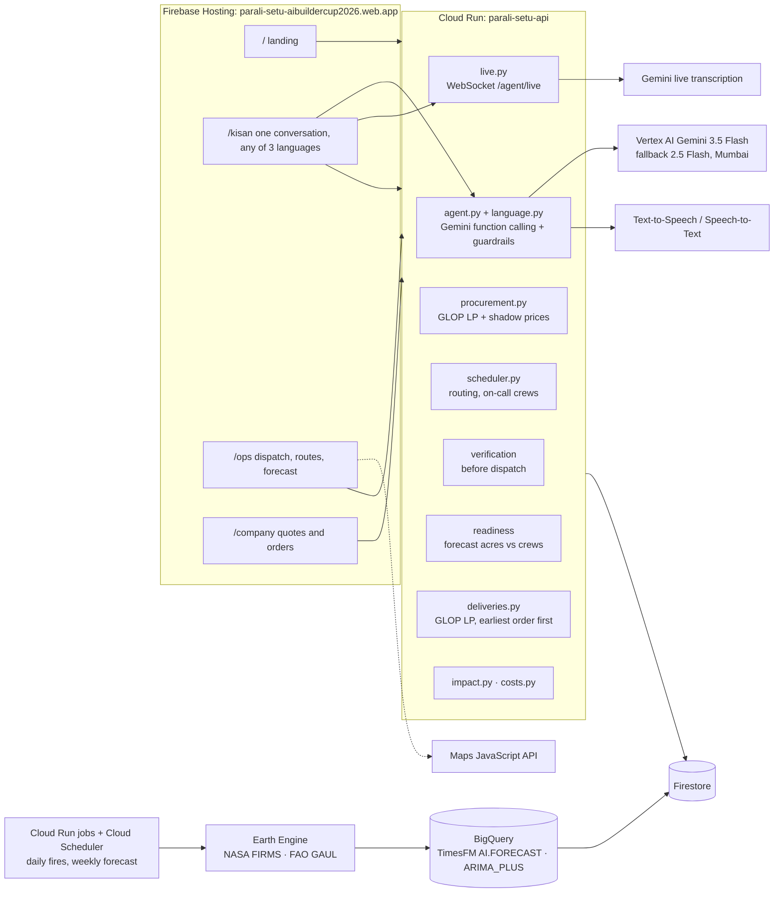
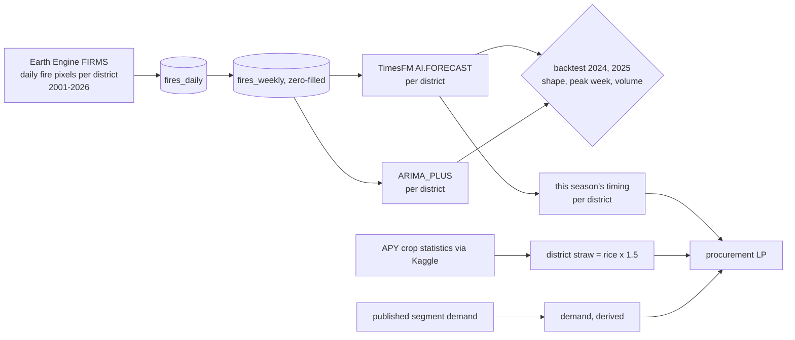
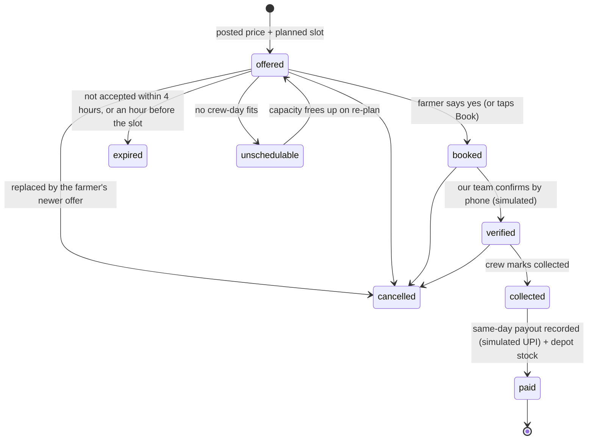

# Parali Setu architecture (2.1)

Parali Setu buys paddy straw from farmers, collects it before wheat sowing, pays the same
day, stores it at depots and supplies companies all year. This document describes the
system as built. The Mermaid diagrams render on GitHub; the presentation versions are in
Lucid ([architecture](https://lucid.app/lucidchart/71517140-63d4-45a5-8994-0c0a74ad539d/view),
[booking flow](https://lucid.app/lucidchart/e03e3d31-b761-48cd-9826-31183ce98f61/view)) and
exported to `parali-setu-frontend/img/`.



## Who owns which output

| Layer | Code | Owns | Never does |
|---|---|---|---|
| Language | `agent.py`, `language.py`, `live.py`, `extraction.py`, `speech.py`, `phrases.py` | Which language the farmer speaks, understanding them (audio, text, photos), asking and cross-checking, explaining | Produce a price, weight, payout, date or slot |
| Forecast | `forecast/` (Earth Engine, BigQuery) | When straw comes off the fields (TimesFM), how much (crop statistics), who buys it (published figures) | Run at request time |
| Planning | `procurement.py`, `scheduler.py`, `deliveries.py`, `costs.py`, `operations.readiness` | Posted prices, what to buy where, crew slots and on-call crews, monthly deliveries, quotes and what we can commit, crews needed for the forecast | Talk to anyone |
| Operations | `operations.py`, `pickups.py`, `firestore_store.py` | Bookings, verification before dispatch, offer expiry, same-day payouts, depot stock | Decide a number itself |

## Deployment



Cost protection (`ops/cost-guard/`) is unchanged:
- **Budgets:** a gross-usage budget, and a ₹100 real-money budget that publishes to Pub/Sub.
- **The guard:** a Cloud Run function closes the API's ingress and turns off the AI APIs if real money is ever charged.
- **Limits:** `--max-instances 3` on the API.

## The farmer agent

```mermaid
sequenceDiagram
  actor F as Farmer (any screen)
  participant API as /agent/turn or /agent/live
  participant L as language.py
  participant G as Gemini 3.5 Flash (fallback 2.5 Flash)
  participant T as Tools (planners, Firestore)
  participant TTS as /speech (Text-to-Speech)
  F->>API: text, a recording, or live audio (captions stream back)
  API->>L: which language? (script and cue words; other scripts get a trilingual reply)
  par English record
    API->>G: translate for the records (background)
  and the turn
    loop at most 5 steps (usually 2)
      API->>G: history + facts + tools, language restated in the turn
      G-->>API: function call, e.g. update_listing (returns the offer once complete)
      API->>T: run the tool (cross-checks, locked posted price, routing within 1 s)
      T-->>API: result
    end
    G-->>API: reply text
  end
  API->>API: guardrails: numbers, claims, language; one rewrite, else a template
  API-->>F: reply text + cards (offer, booked) at once
  F->>TTS: fetch the spoken reply alongside
```

**Tools:**
- `get_todays_price`
- `update_listing` (with `clear_fields`; returns the offer as soon as nothing is missing)
- `find_pickup_slot` (the same details keep the same offer)
- `confirm_booking`
- `get_service_terms` (payment, weighing, no-shows, who we are, how the price is set, what we take care of)
- `my_bookings`
- `cancel_booking`

**Guardrails enforced in code:**
- **Numbers.** Every number in a reply must appear among the tools' returned values or in the farmer's own words. Identifiers are excluded, so a random id can't license digits.
- **Claims.** No "government" rate, no schemes or subsidies, no "trust us": we are a private company and payments are simulated (unless the farmer raised the word, so the agent can say no).
- **Language.** A reply in another script than the farmer's language is rewritten.
- A violation of any of these triggers one rewrite. If that fails, a deterministic template built from tool results is used.
- **An explicit yes.** `confirm_booking` needs an offer shown in an earlier turn, and the farmer's latest words must say yes. That is checked in their language and in English; a question or a "no" never counts.
- **Who and where.** No offer without a name and a valid 10-digit mobile. The farm location is a demo pin near the stated village (the prototype never reads the device's location).
- **Cross-checks.** An acres-versus-weight mismatch, a sowing date already past, or a harvest after sowing blocks booking until it is resolved; a sowing date within 2 days is flagged.
- **Scope and size.** Off-topic requests declined, bounded input, at most 5 tool calls per turn and 40 turns per conversation.
- **Records.** Every turn stores the farmer's words, an English rendering and a guardrail report, so ops can audit it (`GET /agent/conversations/{id}`).

**Speed.** A primary step has 5 s, then the fallback model in Mumbai; a rate-limited primary is skipped for 30 s, and once the fallback answers it keeps the rest of the turn (the two models sign function calls differently). Thinking is off for these calls.

## Forecasting



Fires are used for **timing only**. Enforcement cut fire counts from 2022 while the burned
area held steady, so volume comes from crop statistics. In the backtests, TimesFM placed the
season peak within 0.7–0.8 weeks and had the lowest shape error in both years.

## The three planners

**Procurement: `procurement.py`, a GLOP linear program, run daily.**
- **Variables:** tonnes bought per district, per depot and per week; own and partner intake per depot and week; sales against signed orders and against forecast demand.
- **Constraints:**
  - bookable straw per district and week (straw × TimesFM timing share × expected booking share)
  - depot capacity and radius
  - crew capacity (own and partner)
  - signed orders met before spot sales, with any shortfall penalised and reported
- **Objective:** margin, which is sales − farm-gate − haul to depot − collection − storage.
- **Posted price** = ₹0.60/kg + half the shadow price of that district's supply constraint this week, kept within ₹0.5–1.5/kg. When the plan wants more straw from a district than farmers are expected to book, the price rises, and the reason is stated.

**Pickups: `scheduler.py`, an OR-Tools routing model.**
- **Vehicles:** each crew on each day of a 10-day horizon is one vehicle, starting and ending at its depot within a 07:00–18:00 shift.
- **Farm visits:** service time is acres ÷ 2 acres/hour. A visit's window runs from the ready date to the day before sowing.
- **Splitting:** visits are capped by daily capacity and by what fits in a shift after the round trip.
- **Two passes:** our own crews first, then **on-call crews** (a pool of 8 per depot, hired by the day) only for farms ours can't fit. That is how every booking gets a slot; each on-call crew used is a hire with its cost on the Dispatch board.
- **Locks and capacity:** accepted slots are locked. Work already collected today reduces that crew-day's capacity. The agent's planning call is capped at 1 s.
- **Unschedulable farms** get a reason code: `booked`, `no_capacity`, `deadline_passed`, `too_far`, `beyond_horizon` or `lock_lost`.

**Deliveries: `deliveries.py`, a GLOP linear program, run monthly.**
- Ships from depot stock to each order month, with stock carried from month to month.
- Minimises haulage + storage + a shortfall penalty, and reports any shortfall.
- **Earliest signed first:** an order's shortfall penalty rises with its place in the queue, so a later order absorbs any shortage and never takes stock from an earlier one.
- **What we can commit:** a quote re-runs procurement with the candidate order on the book (`operations.committable`); an order we cannot fill is refused unless the customer accepts a smaller one.

**Readiness: `operations.readiness`.**
- For each of the next three weeks and each depot: the acres farmers are forecast to book (TimesFM timing x district straw x a 0.5% booking share, spread over working days), against our own crews' acres per day.
- The gap becomes on-call crews to hire from the depot's pool, and anything beyond the pool becomes crews to sign up before the peak.

## Booking lifecycle



## Data model (Firestore)

| Collection | Holds |
|---|---|
| `listings`, `listing_drafts` | The farmer's field: name, phone, acres, kg, crop, district, location (and whether it is a demo pin), sowing date |
| `bookings` | Listing → depot at the posted price; lifecycle status, verification record (pending, verified, needs a change), reason code, payout |
| `depots`, `crews`, `pickup_slots` | Storage sites and radius; own and on-call crews; planned visits (arrival window, planned start and end, locked flag) |
| `posted_prices` | Price per district per day (locked once posted), shadow price, reason |
| `purchases`, `inventory_moves` | Same-day payouts; straw in and out of each depot |
| `customers`, `orders`, `deliveries` | Companies, forward orders with quote, PO code and status (cancelled orders keep their record), planned monthly shipments |
| `plans` | Latest procurement and delivery plans with their assumptions |
| `forecasts` | TimesFM live forecast and backtest results |
| `conversations` | Agent turns, English records, tool facts, guardrail reports |
| `farmers`, `no_burn_proofs`, `fire_detections` | Trust score, photo proofs, the latest FIRMS batch |

## Known limitations

- **Demo and simulated data:** farms, customers and crews are demo data, and the on-call pool is simulated. Confirmation calls, SMS and payments are simulated.
- **Cost assumptions:** collection, freight and storage costs are working assumptions, labelled as such on the ops console.
- **Travel times** are straight-line × 1.3 at 30 km/h, not road routes.
- **Forecast inputs:** the forecast predicts timing, not volume. Demand is derived from published figures.
- **Latency:** a typed turn is a median of about 5.8 s over HTTP (Gemini's 1–3 s per call is the floor); streaming replies are on the roadmap.
- **Booking share** (0.5%) and the on-call pool size are assumptions that set the readiness numbers.
