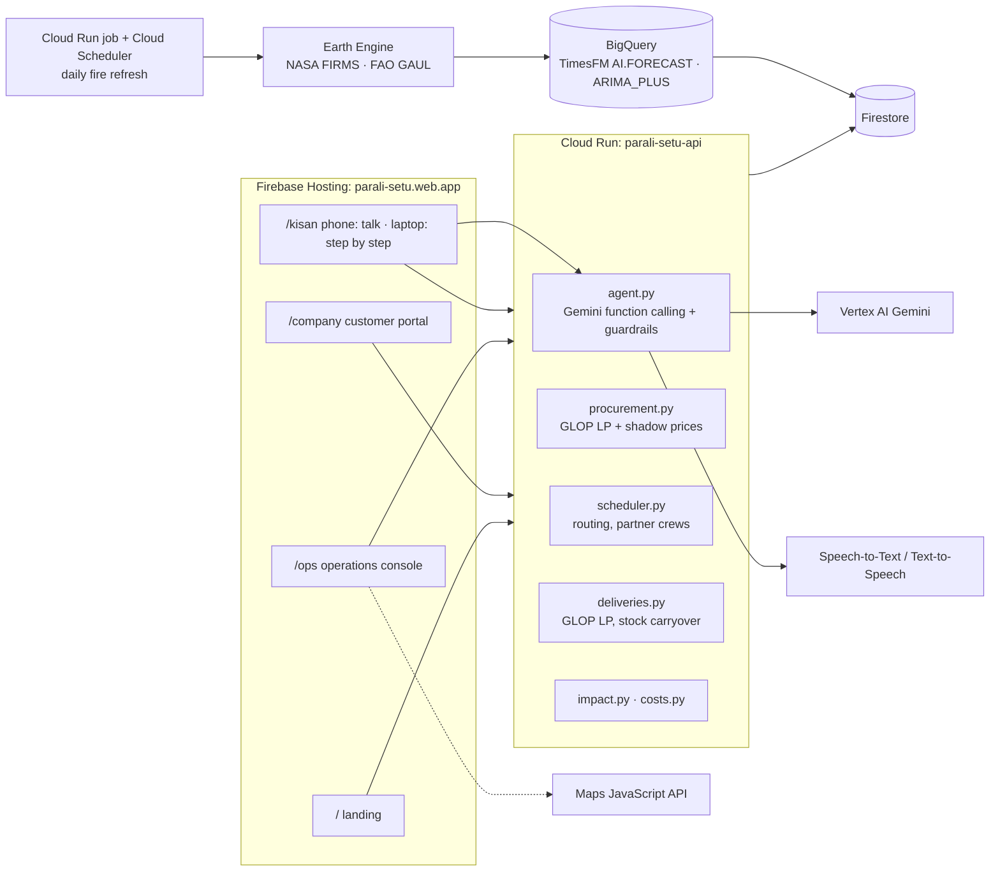
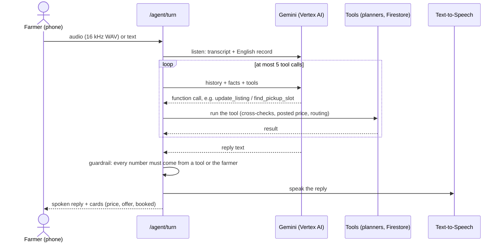
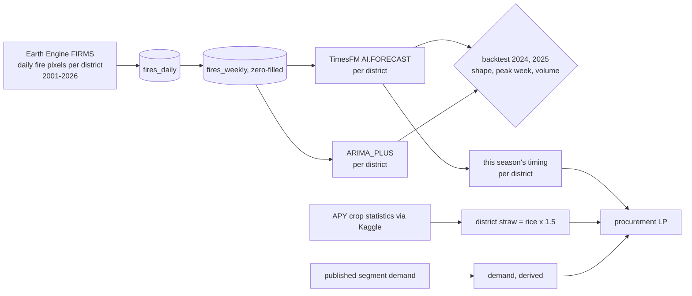
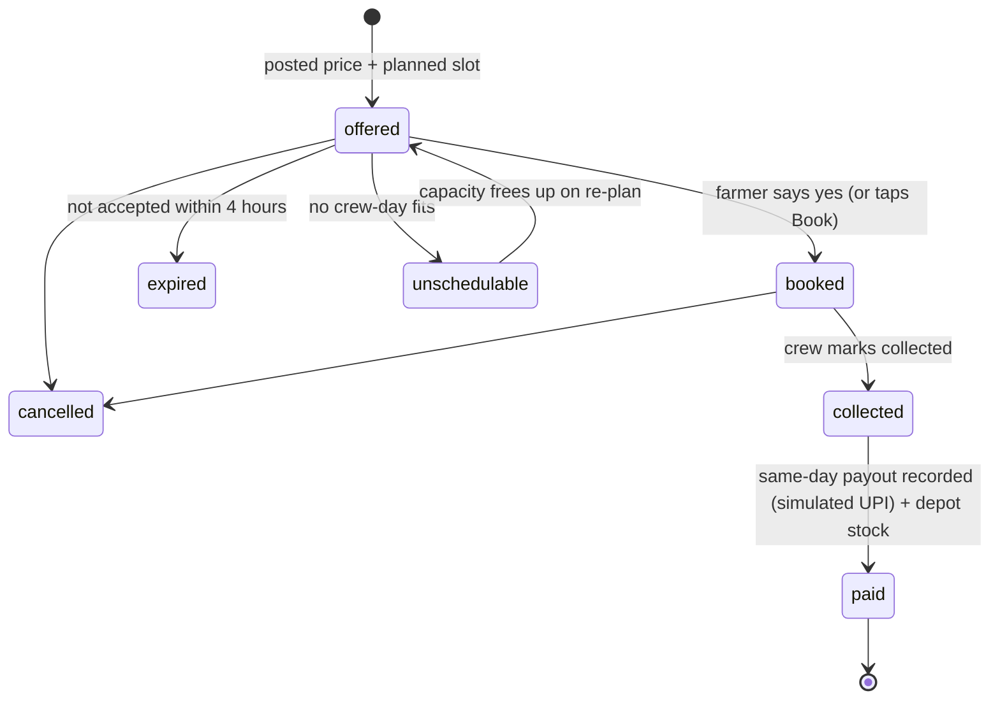

# Parali Setu architecture (2.0)

Parali Setu buys paddy straw from farmers, collects it before wheat sowing, pays the same
day, stores it at depots and supplies companies all year. This document describes the
system as built. The diagrams render on GitHub.

## Who owns which output

| Layer | Code | Owns | Never does |
|---|---|---|---|
| Language | `agent.py`, `extraction.py`, `speech.py`, `phrases.py` | Understanding the farmer (audio, text, photos), asking and cross-checking, explaining | Produce a price, weight, payout, date or slot |
| Forecast | `forecast/` (Earth Engine, BigQuery) | When straw comes off the fields (TimesFM), how much (crop statistics), who buys it (published figures) | Run at request time |
| Planning | `procurement.py`, `scheduler.py`, `deliveries.py`, `costs.py` | Posted prices, what to buy where, crew slots, monthly deliveries, quotes | Talk to anyone |
| Operations | `operations.py`, `pickups.py`, `firestore_store.py` | Bookings, offer expiry, same-day payouts, depot stock | Decide a number itself |

## Deployment

Cost protection (`ops/cost-guard/`) is unchanged:
- **Budgets:** a gross-usage budget, and a ₹100 real-money budget that publishes to Pub/Sub.
- **The guard:** a Cloud Run function closes the API's ingress and turns off the AI APIs if real money is ever charged.
- **Limits:** `--max-instances 3` on the API.

## The farmer agent

**Tools:**
- `get_todays_price`
- `update_listing` (with `clear_fields`)
- `find_pickup_slot`
- `confirm_booking`
- `my_bookings`
- `cancel_booking`

**Guardrails enforced in code:**
- **Numbers.** Every number in a reply must appear among the tools' returned values or in the farmer's own words. Identifiers are excluded, so a random id can't license digits. A violation triggers one rewrite. If that fails, a deterministic template built from tool results is used.
- **An explicit yes.** `confirm_booking` needs an offer shown in an earlier turn, and the farmer's latest words must say yes. That is checked in their language and in English; a question or a "no" never counts.
- **Cross-checks.** An acres-versus-weight mismatch, a sowing date already past, or a harvest after sowing blocks booking until it is resolved.
- **Scope and size.** One reply language, off-topic requests declined, bounded input, at most 5 tool calls per turn and 40 turns per conversation.
- **Records.** Every turn stores the farmer's words, an English rendering and a guardrail report, so ops can audit it (`GET /agent/conversations/{id}`).

## Forecasting

Fires are used for **timing only**. Enforcement cut fire counts from 2022 while the burned
area held steady, so volume comes from crop statistics. In the backtests, TimesFM placed the
season peak within 0.7–0.8 weeks and had the lowest shape error in both years.

## The three planners

**Procurement: `procurement.py`, a GLOP linear program, run daily.**
- **Variables:** tonnes bought per district, per depot and per week; own and partner intake per depot and week; sales against signed orders and against forecast demand.
- **Constraints:**
  - bookable straw per district and week (straw × TimesFM timing share × expected booking share)
  - depot capacity and radius
  - crew capacity (own and partner)
  - signed orders met before spot sales, with any shortfall penalised and reported
- **Objective:** margin, which is sales − farm-gate − haul to depot − collection − storage.
- **Posted price** = ₹0.60/kg + half the shadow price of that district's supply constraint this week, kept within ₹0.5–1.5/kg. When the plan wants more straw from a district than farmers are expected to book, the price rises, and the reason is stated.

**Pickups: `scheduler.py`, an OR-Tools routing model.**
- **Vehicles:** each crew on each day of a 10-day horizon is one vehicle, starting and ending at its depot within a 07:00–18:00 shift.
- **Farm visits:** service time is acres ÷ 2 acres/hour. A visit's window runs from the ready date to the day before sowing.
- **Splitting:** visits are capped by daily capacity and by what fits in a shift after the round trip.
- **Two passes:** our own crews first, then partner crews only for farms ours can't fit. That is how every booking gets a slot, and the extra cost stays visible.
- **Locks and capacity:** accepted slots are locked. Work already collected today reduces that crew-day's capacity.
- **Unschedulable farms** get a reason code: `booked`, `no_capacity`, `deadline_passed`, `too_far`, `beyond_horizon` or `lock_lost`.

**Deliveries: `deliveries.py`, a GLOP linear program, run monthly.**
- Ships from depot stock to each order month, with stock carried from month to month.
- Minimises haulage + storage + a shortfall penalty, and reports any shortfall.

## Booking lifecycle

## Data model (Firestore)

| Collection | Holds |
|---|---|
| `listings`, `listing_drafts` | The farmer's field: acres, kg, crop, district, location, sowing date, optional phone |
| `bookings` | Listing → depot at the posted price; lifecycle status, reason code, payout |
| `depots`, `crews`, `pickup_slots` | Storage sites and radius; own and partner crews; planned visits (arrival window, planned start and end, locked flag) |
| `posted_prices` | Price per district per day, shadow price, reason |
| `purchases`, `inventory_moves` | Same-day payouts; straw in and out of each depot |
| `customers`, `orders`, `deliveries` | Companies, forward orders with quote, planned monthly shipments |
| `plans` | Latest procurement and delivery plans with their assumptions |
| `forecasts` | TimesFM live forecast and backtest results |
| `conversations` | Agent turns, English records, tool facts, guardrail reports |
| `farmers`, `no_burn_proofs`, `fire_detections` | Trust score, photo proofs, the latest FIRMS batch |

## Known limitations

- **Demo and simulated data:** farms, customers and crews are demo data, and partner capacity is a simulated pool. Payments are simulated.
- **Cost assumptions:** collection, freight and storage costs are working assumptions, labelled as such on the ops console.
- **Travel times** are straight-line × 1.3 at 30 km/h, not road routes.
- **Forecast inputs:** the forecast predicts timing, not volume. Demand is derived from published figures.
- **Gemini Live** is not in the product yet (see the README roadmap).
